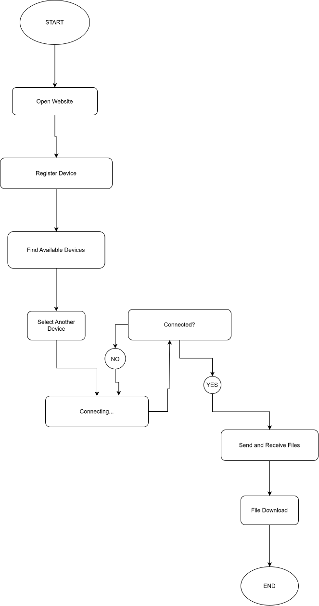

# Local File-Transfer
A peer-peer data sharing web application that allows users to transfer data between different operating systems and devices without uploading data to cloud storage.


## Overview

Local Data Transfer aims to make data sharing simple across devices. Users can connect through a web browser and transfer files directly between devices using WebRTC irrespective of Operative system.

The project is designed to support Windows, Linux, macOS, Android, and iOS browsers without requiring separate data-sharing applications installed.


## Features

- Cross-device data sharing through a web browser.
- Device registration and discovery.
- Real-time communication using Socket.IO.
- Peer-to-peer data transfer using WebRTC DataChannels.
- File selection and sending.
- File receiving and downloading.
- Transfer progress tracking.
- Separate frontend and backend architecture.

## Technologies Used

### Frontend

In frontend people use to register devices, connect and send or receive files.
- React.js
- JavaScript
- CSS
- Socket.IO Client
- WebRTC

### Backend

Backend helps devices discover each other and exchange connection information.
- Node.js
- Express.js
- Socket.IO
- HTTP

## How It Works

1. A user opens the application in a browser.
2. The device connects to the backend server.
3. The user registers their device.
4. Available devices are displayed.
5. The user selects another device to connect with.
6. Socket.IO exchanges the signaling information required to establish a WebRTC connection.
7. Once the peer-to-peer connection is established, files are transferred directly between the devices.

**Important:** The backend handles device discovery and signaling. File data is intended to travel directly between connected devices rather than being stored on the backend.

## Project Flowchart

The following flowchart illustrates the initial workflow of the project, from opening the website to transferring files between devices.



## Getting Started

### Prerequisites

- Node.js
- npm
- A modern web browser

### 1. Clone the Repository

```bash
git clone https://github.com/vivek02-xo/file-transfer
cd file-transfer
```

### 2. Set Up the Backend

```bash
cd server
npm install
```

Create a `.env` file inside the `server` directory:

```env
PORT=4000
FRONTEND_URL=http://localhost:3000
```

Start the backend:

```bash
npm start
```

### 3. Set Up the Frontend

Open another terminal:

```bash
cd frontend
npm install
```

Create a `.env` file inside the `frontend` directory:

```env
REACT_APP_SERVER_URL=http://localhost:4000
```

Start the frontend:

```bash
npm start
```

Open the application:

```text
http://localhost:3000
```

## Local Network Support

The project is designed to support file transfers between devices connected to the same local network or compatible hotspot network.

The goal is to transfer files directly between devices without using internet bandwidth for the file contents.

Actual connectivity depends on network configuration, firewall rules, browser support, and WebRTC connectivity.

## Current Limitations

- Direct peer-to-peer connectivity may not work on every network.
- Some Wi-Fi networks and hotspots may block communication between connected devices.
- Browser compatibility may vary across devices.
- The project is still under development.

## Future Improvements

- Improve connection reliability.
- Add secure device pairing.
- Improve large-file transfer handling and speed of transfering files.
- Add transfer aproval/cancellation from receiving device.
- Improve mobile browser compatibility.
- Improve UI.
- Expand cross-platform testing.

## 🚧 Project Status

**Development**

This project is currently under development. Core features are being implemented, and testing is ongoing.

Some features may not work as expected yet. More improvements and functionality will be added in future Commits.

This project is actively being developed as a cross-platform, browser-based file-sharing solution.

## License

This project is intended to be released under the MIT License. See the [MIT License](LICENSE) file for details.
